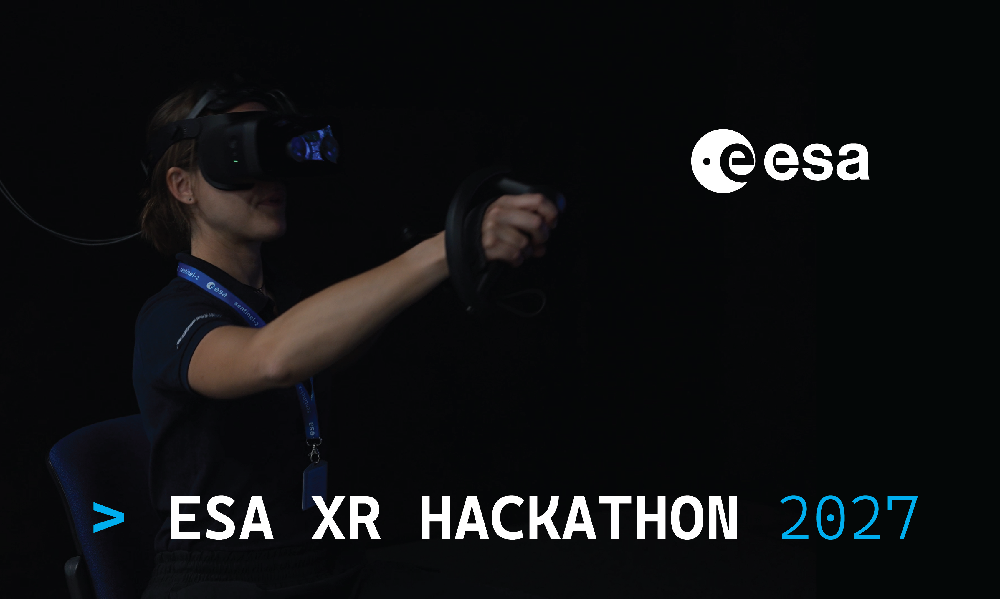

# ESA XR Hackathon

Welcome to the official GitHub workspace for the **ESA XR Hackathon**! 🚀

This is the place where your team will **work, collaborate and submit your project** during the hackathon.

## 👥 Create or Join a Team

To get started, you can create a **Team** within this GitHub organization. If you want to develop alone, then you can skip this step.

- **Looking for more team members?** Make your Team **visible**, so other participants can discover it and ask to join.
- **Your team is already complete?** You can keep your Team **secret**.
- Use your Team and its repository to collaborate, develop your solution and prepare your final submission.

## 📦 Submit Your Project

Your GitHub repository will also serve as your **official hackathon submission**.

Make sure you follow the required repository structure, documentation and submission process described in the official **Submission Instructions**:

👉 **[Read the Submission Instructions](https://xr.esa.int/hackathon/#online#submission)**

For general information, challenges and hackathon details, visit the **[ESA XR Hackathon website](https://xr.esa.int/hackathon/)**.

**Build, experiment, collaborate and show us what XR can bring to space**
